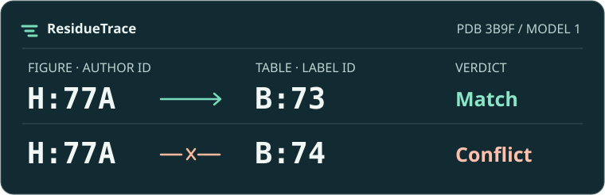

# ResidueTrace

**Does the residue marked in your figure match the one in your results table?** ResidueTrace checks both references against the same protein structure and shows which residue each one identifies.

[Read the worked example](docs/case-3b9f.md) · [Try it locally](#try-it-locally) · [简体中文](README.zh-CN.md)



In structure **3B9F**, the authors’ numbering calls one residue `H:77A`; the archive’s standard numbering calls it `B:73`. Both are correct. Change the table entry to `B:74` and it still **looks valid**, but now it points to a different residue. The identifiers are from the archive; the mismatch is an example, not a reported error in the paper.

## What you get

Give ResidueTrace an annotated figure, a CSV table and an mmCIF structure, linked by a [small manifest](src/residuetrace/demo/manifest.json). It checks the **declared identifiers**, not the image pixels. If a chain is missing or a reference is ambiguous, it won't guess.

- **For authors and reviewers:** open the offline HTML report, compare the two identifiers, and follow a figure box to its exact table row. [Download a sample report](docs/examples/3b9f-conflict.html?raw=1) and open it in your browser.
- **For analysis pipelines:** read the same verdicts and supporting records as JSON. The [input and output reference](docs/reference.md) covers formats, statuses and exit codes.

## Try it locally

Requires Python 3.11+. Run these commands in a Python environment of your choice:

```sh
git clone https://github.com/0G-Bhqc/ResidueTrace.git
cd ResidueTrace
python -m pip install .
python -m residuetrace demo --out out/demo
```

Open `out/demo/report.html`. The included teaching example is synthetic and should pass. To see an intentional mismatch before installing anything, [inspect the 3B9F evidence](docs/case-3b9f.md). The audit runs offline; installing dependencies may require a connection. Reports embed the supplied figure and table fields, so share them as carefully as the originals.

[Benchmark and data provenance](benchmark/README.md) · [API and file formats](docs/reference.md) · [0BSD software license](LICENSE)
