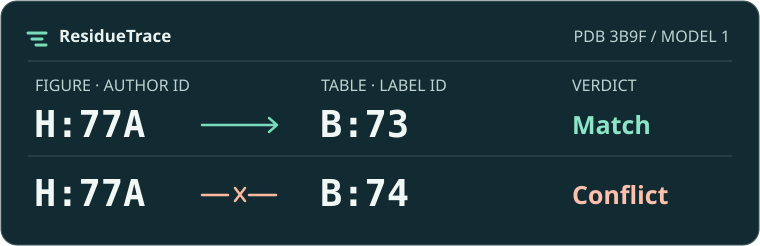

# ResidueTrace

**图里标出的残基，和结果表里写的是同一个吗？** ResidueTrace 用同一份蛋白质结构档案核对两处编号，并列出它们各自指向的残基。

[看一个实际编号案例](docs/case-3b9f.md) · [在本地试用](#在本地试用) · [English](README.md)



以结构 **3B9F** 为例：同一个残基，作者编号是 `H:77A`，档案的标准编号是 `B:73`。如果表格误填成 `B:74`，这个编号**也确实存在**，但它指向另一个残基。上图的编号取自真实档案；错配是为了演示而构造的，不代表原论文有错。

## 核对后能看到什么？

输入带标注的图片、CSV 表格和 mmCIF 结构文件，用一份[清单](src/residuetrace/demo/manifest.json)指明要比对的图框和表行。工具核对标注**声明的编号**，不看像素猜残基；缺少链号或有多种解释时，也不会判定通过。

- **投稿前复核或审稿：** 在离线 HTML 报告中并排查看图、表各自指向的残基，点击图框就能追到原始表行。[下载示例报告](docs/examples/3b9f-conflict.html?raw=1)，用浏览器打开即可，无需安装。
- **接入分析流程：** 同一份结论和档案证据也会写入 JSON。[输入输出参考](docs/reference.md)说明字段、判定状态与退出码。

## 在本地试用

需要 Python 3.11 或更高版本。在自己的 Python 环境中运行：

```sh
git clone https://github.com/0G-Bhqc/ResidueTrace.git
cd ResidueTrace
python -m pip install .
python -m residuetrace demo --out out/demo
```

打开 `out/demo/report.html`。内置教学示例是合成数据，预期结果为通过；不安装也可以[查看 3B9F 的错配依据](docs/case-3b9f.md)。核验时不联网，首次安装依赖可能需要联网。报告包含原图和表格字段，分享前请按原始数据的敏感程度检查。

[评测与数据出处](benchmark/README.md) · [API 与文件格式](docs/reference.md) · [0BSD 软件许可](LICENSE)
