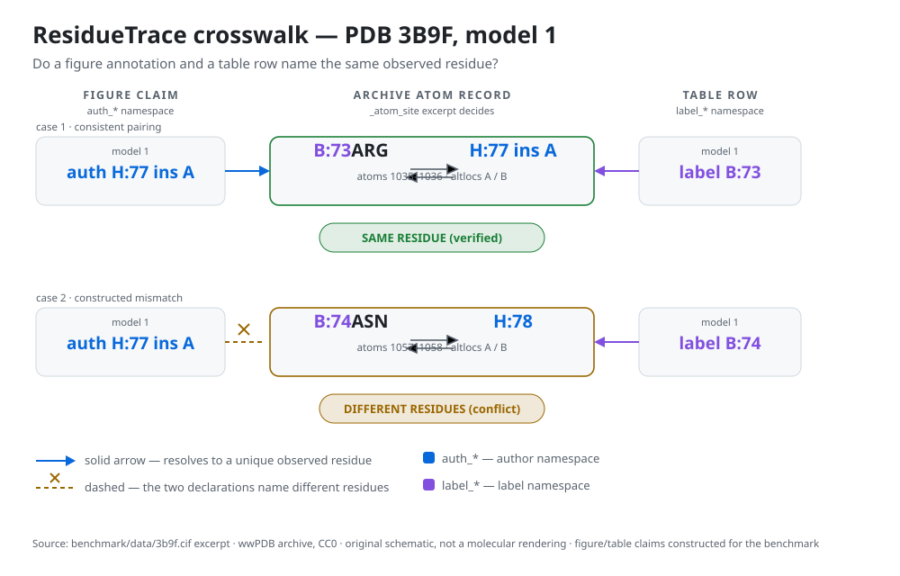

# 3B9F: when two valid residue labels disagree

[English overview](../README.md) · [中文首页](../README.zh-CN.md) · [Download the offline report](examples/3b9f-conflict.html?raw=1)

The figure marks **H:77A**. Does a table entry of **B:74** name the same residue? **No.** In model 1 of [PDB 3B9F](https://www.rcsb.org/structure/3B9F), the archive maps H:77A to **B:73 (ARG)**. B:74 is also a valid identifier, but refers to **H:78 (ASN)**.

**中文：** 图注 `H:77A` 对应档案中的 `B:73`，不对应 `B:74`。编号来自真实结构；图注和表行是为演示而构造的，并不是在纠正原论文。

| Same figure annotation | Table entry | What the archive says | Verdict |
|---|---|---|---|
| H:77A | B:73 | Both identify ARG | **Match** (`verified`) |
| H:77A | B:74 | Figure identifies ARG; table identifies ASN | **Conflict** (`conflict`) |

The `A` in **H:77A** is an insertion code. The figure uses the authors’ numbering (`auth`); the table uses standardized numbering (`label`). Comparing the strings alone would incorrectly reject the first row as well as the second.

## Follow the evidence

1. **Start with the figure.** The region `selection` is linked to the CSV by the key `r17`. Its declaration: model `1`, author chain `H`, sequence number `77`, insertion code `A`.
2. **Read the table independently.** CSV line 2 in the conflict example declares model `1`, label chain `B`, position `74`.
3. **Check the [atom records](../benchmark/data/3b9f.cif).** Here are the fields needed to decide. Atom IDs below are archive IDs, not file line numbers. The alternate locations share the same residue identifiers.

| Model | Author chain / number / insertion | Label chain / position | Component | Atom IDs in the excerpt |
|---|---|---|---|---|
| 1 | H / 77 / A | B / 73 | ARG | 1035, 1036 |
| 1 | H / 78 / no recorded insertion | B / 74 | ASN | 1057, 1058 |

[Save the standalone HTML report](examples/3b9f-conflict.html?raw=1) and open it locally. Click the figure box, then the link to CSV line 2. Both claims have exactly one match in the structure: the conflict is between them. If a declaration instead omits the chain, the audit reports insufficient information and does not guess.

<details>
<summary>Detailed numbering diagram</summary>



</details>

## Reproduce and cite

With ResidueTrace installed, run this from the repository root, using a new filename:

```sh
python -I benchmark/export_example.py local-3b9f-report.html
```

The [benchmark](../benchmark/README.md) contains 12 diagnostic cases on two structures. Its schematics and claims are illustrative; it does not evaluate image recognition or biological function. Only the atom records are from the deposition.

[3B9F publication](https://doi.org/10.1073/pnas.0711055105) · [wwPDB data terms (CC0)](https://www.wwpdb.org/about/usage-policies) · [Input and output reference](reference.md)
